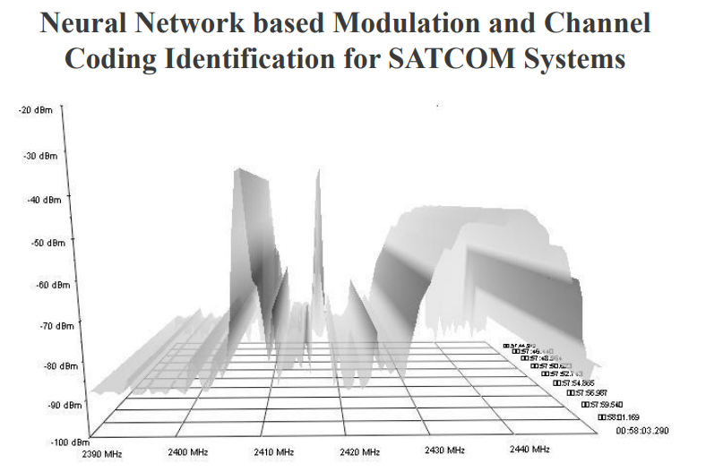
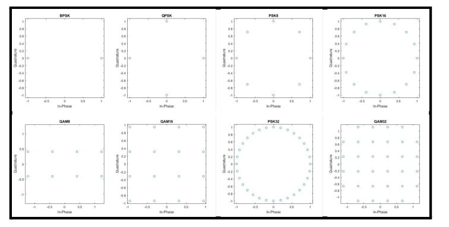
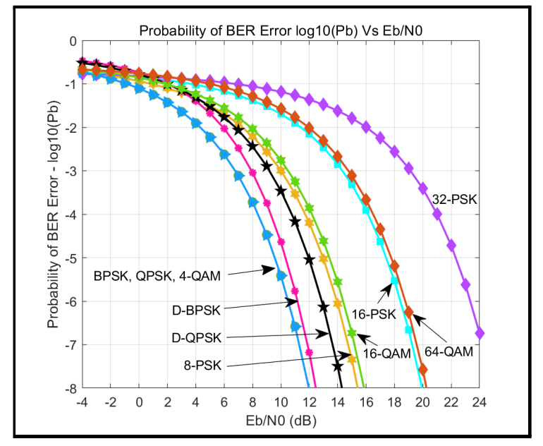
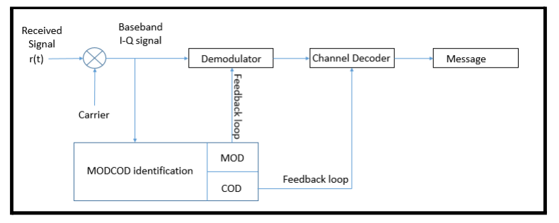
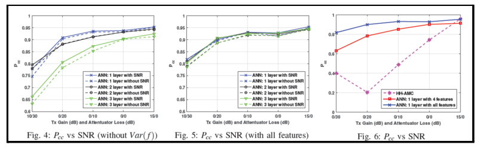
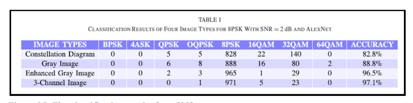
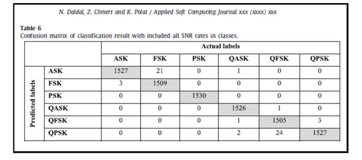
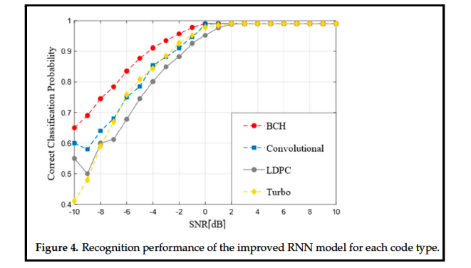

# [Modulation Identification] Satellite Communication + Neural Network, Real-time Modulation Identification Technology Deployed [with Python Code]

Personal Blog: https://www.cnblogs.com/EWFrontier  
✿Breakthrough at 96% accuracy! Satellite communication + neural network, real-time modulation recognition technology is implemented~✿In the fields of military reconnaissance, civil spectrum management, satellite communication (SATCOM), etc., "Automatic identification of signal modulation and coding scheme" is a core technical challenge - only accurate recognition can achieve correct demodulation and interpretation of signals. The research team from NUST University in Pakistan has completed a real-time modulation recognition system based on neural networks with four milestone breakthroughs, achieving the highest accuracy of 96.4%, making the "intelligent interpretation" of satellite communication from the laboratory to practical application!  
Traditional recognition methods either rely on manual setting thresholds or perform poorly under complex noise and channel fading. In the context of satellite communication scenarios, signals often suffer from Doppler effects and channel fading, making traditional solutions difficult to handle - this is precisely the core pain point that the research team aims to solve: using AI to enable systems to "automatically, accurately, and real-time" identify modulation and coding schemes.  
II. Four Milestones, A Complete Path From Theory to Reality  
The entire project took 8 months and was steadily progressed into four stages, each landing on critical nodes:  
1. Stage One: Literature Review + Feasibility Assessment (Establishing the Foundation)  
The team first organized classic communication models, modulation and coding schemes (Turbo codes, LDPC codes, BPSK/QPSK, etc.), compared the limitations of traditional recognition methods (likelihood methods, feature methods), and ultimately determined that "neural networks" were the optimal solution - they can automatically learn signal features without requiring human design of thresholds, and have stronger anti-noise and anti-fading capabilities.  
At the same time, a preliminary hardware test platform (USRP N200 SDR, GPU servers, etc.) was established to verify the technical feasibility of the project.
2. Phase II: Data Set + Neural Network Model (Core Breakthrough) To enable AI to learn to recognize, it is essential to have "textbooks" - the team has generated datasets covering six modulation methods (BPSK, QPSK, PSK-8, etc.), three coding schemes (LDPC, Turbo, Polar), including scenarios with different signal-to-noise ratios (-4dB~14dB) and channel fading (Rayleigh, Rician fading).
Based on this, 19 modulation recognition models and 2 coding recognition models were designed. Among them, Model #10 (1D-CNN architecture) performed exceptionally well: with an accuracy rate of 99.8% in the absence of fading, even when used in fading scenarios, the accuracy rate was still over 90% after optimization through transfer learning.
3. Phase Three: SDR System Integrated (Hardware Landing) - Models alone are not enough; they need to run on hardware! The team built an SDR (Software-Defined Radio) system using GNU Radio, achieving:
✧  
Real-time signal transmission and reception (2 USRP N200 used as transmitter and receiver respectively);
✧  
Phase correction, SNR real-time monitoring, gain adjustment;
✧  
Data is transmitted via the ZMQ protocol, seamlessly integrating with neural network models.
The key upgraded Model#10a (input window 512, 4 hidden layers) achieved an accuracy of 96.4% in the real-air dataset test, completely solving the pain point of "the model is good in the lab but fails in real scenarios".
4. Phase Four: Real-time Prototype + GUI Interface (User-Available) The final prototype system, which is not only capable of real-time signal recognition but also features a user-friendly GUI interface.
✧  
One-click model loading, analysis start, results with timestamp display;
✧  
Supports recognition of 6 core modulation modes, with strong anti-interference capability.
✧  
Tx/Rx gain can be adjusted in real-time, suitable for different communication scenarios.
Now, just open the GUI, connect SDR hardware, and you can read the "transmission garb" of satellite communication signals in real time, greatly reducing the operating barriers!
3. Core highlights: Why is this system so powerful? 1
High accuracy + interference resistance: A real-time recognition rate of 96.4%, stable operation even in Rayleigh/Rice fading and low signal-to-noise ratio environments;
2
3
Full process automation: From signal acquisition, preprocessing to recognition, no human intervention required, truly realizing "real-time response";
4
Easy to use: Visualized GUI interface, non-professionals can also operate quickly, adaptable to laboratory demonstrations, field tests, and other scenarios.
4. Future prospects: These directions can still be broken through! The current system has completed the implementation of modulation recognition, but the research team has even greater goals:
✧
Add more modulation methods such as QAM-64, OQPSK, etc., to enhance the system's universality;
✧
Explore blind recognition methods for channel coding (current encoding recognition still faces technical bottlenecks);
✧
Adapt to OFDM signals, covering more communication scenarios such as Wi-Fi, 5G, WiMAX;
✧
Promote the design of "end-to-end neural networks" for satellite communication scenarios, further improving recognition speed.
From literature review to hardware landing, from laboratory data to real-time recognition, this project proves the great potential of neural networks in the field of satellite communication with a combination of "theoretical + practice." In the future, as technology evolves, we may see more "smart signal interpretation" systems, making satellite communication and spectrum management more efficient and precise...
★

## Images

<!-- PAYMENT_BLOCK -->

## Get this dataset

- Payment link (Stripe): [Buy now](https://buy.stripe.com/3cs8yP7sY87d0vu9AB)
- Payment QR code: 

<!-- /PAYMENT_BLOCK -->
